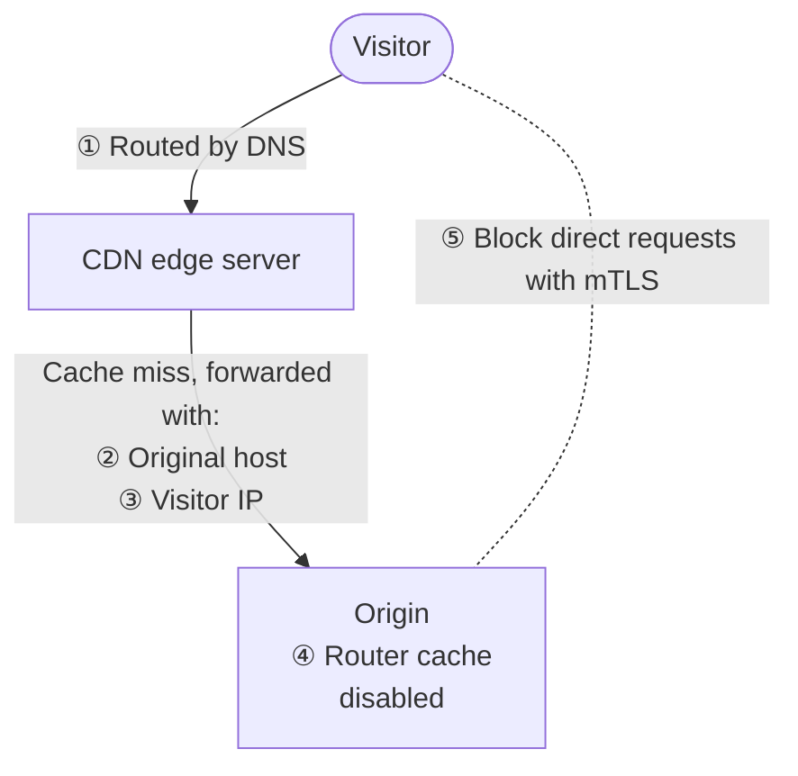

A CDN speeds up the delivery of your site's content by caching it on edge servers around the world, close to your users.

Fastly is the recommended CDN for {} projects.
By default, Dedicated projects include a [Fastly CDN managed by {}](/domains/cdn/managed-fastly.md).
Self-service Grid plans don't include a CDN by default, but you can set up one at any time,
such as [Fastly](/domains/cdn/fastly.md) or [Cloudflare](/domains/cdn/cloudflare.md).

## How requests flow through a CDN

Without a CDN, visitors connect directly to your {} project.
With a CDN, your project (the origin) receives requests from the CDN's edge servers instead,
whenever the requested content isn't already in their cache.



Because the CDN adds a second connection, from the edge server to the origin, setting up a CDN involves more than DNS.
The rest of this page follows the numbered points in the diagram. Not all of them need action from you:

1.  **Required:** [Send visitors to the CDN edge server](#dns-records) with DNS records.
2.  **Required:** [Forward the original `Host` header](#host-header-forwarding) so your project knows which domain the visitor requested.
3.  **Automatic for supported CDNs:** [Keep the visitor's IP address](#client-ip-addresses) so your app and logs see the visitor, not the edge server. Akamai needs some property configuration.
4.  **Recommended:** [Avoid caching twice](#disable-the-router-cache) by disabling the router cache.
5.  **Optional:** [Prevent direct access to your project](#prevent-direct-access-to-your-server) so all requests go through the CDN.

## DNS records

Visitors reach your CDN through DNS: your domain points to the CDN, not to your project.
To start routing client traffic through your CDN, [set up a custom domain](/domains/steps/_index.md).

If you use `CNAME` records for your custom domain, these records [can't point to apex domains](/domains/steps/dns.md).
But most CDN providers offer workarounds.
For example, Fastly offers [Anycast options](/domains/cdn/fastly.md#3-handle-apex-domains)
and Cloudflare offers [`CNAME` flattening](/domains/cdn/cloudflare.md#3-handle-apex-domains).

## Host header forwarding

When the edge server forwards a request, your project needs to know which domain the visitor asked for.

Every HTTP request includes a `Host` header with the domain name the request is for.
Servers that host multiple websites, like a CDN, use it to decide which site handles the request.
When a request goes through a CDN, the edge server rewrites the `Host` header to point to the CDN,
so a request that reaches your project after a cache miss no longer carries your domain.

To pass your domain to your project, configure your CDN to send an `X-Forwarded-Host` header with the original `Host` value.
Use your root domain as the value, for example `example.com`.
For how to set the header, see your CDN provider's documentation.
You might also need to adjust your app's configuration so it handles the `X-Forwarded-Host` header.

## Client IP addresses

Requests forwarded by the CDN arrive from the edge server's IP address, not the visitor's.
When a request comes through a supported CDN, {} checks that the connection
comes from that CDN's edge network, then reads the visitor's IP address from the header the CDN sets.
Your app receives that address in the `X-Client-IP` header, and the access logs and
[classification data headers](/development/headers.md#classification-data-headers) use it instead of the edge server's address.

This works without any configuration for Fastly, Cloudflare, and CloudFront.
Akamai needs some settings in your property configuration; see [Configure Akamai](#configure-akamai).
With any other CDN, `X-Client-IP` contains the edge server's IP address.


Every CDN's edge network is shared by all of that CDN's customers.
Passing this check proves a request came through the CDN's network, not through your property specifically.
If you use `X-Client-IP` or your CDN's own client-IP header to grant access,
also [prevent direct access to your project](#prevent-direct-access-to-your-server).


### Configure Akamai

{} reads the client IP from Akamai's `True-Client-IP` header.
In your Akamai property configuration:

1.  Enable **Send True Client IP Header**.
2.  Disable **Allow Clients To Set True Client IP Header**.
3.  Don't rename the `True-Client-IP` header. Akamai lets you customize it,
    but {} only recognizes the name `true-client-ip`.


If either setting is wrong, visitors can send any value in `True-Client-IP`,
and {} records it as the client IP
in `X-Client-IP`, access logs, and abuse scoring.


## Disable the router cache

Your CDN already caches responses at the edge,
so the {} router [HTTP caching](/define-routes/cache.md) only duplicates that work.
To disable it, change your cache configuration for the routes behind a CDN to the following:

```yaml {configFile="routes"}
"https://{default}/":
  type: upstream
  upstream: "myapp:http"
  cache:
    # Disable the HTTP cache on this route. It's handled by the CDN instead.
    enabled: false
```

## Configure your CDN to support high SLA



If your plan includes high SLA, configure your CDN so that {} can perform automated monitoring using NodePing.
To do so, [add all NodePing IP addresses](https://nodeping.com/faq.html#ip-addresses) to your CDN's allowlist.

If you want {} to limit checks to one or more of the following regions, [contact Support](/learn/overview/get-support.md):

- North America
- Europe
- East Asia / Oceania

## Prevent direct access to your server

Your project still has its own public address,
so visitors can skip the CDN and send requests directly to it (⑤ in the diagram).
These requests bypass any caching and protection the CDN provides.
To prevent this, make your project accept only requests that come from your CDN.

### IP filtering and HTTP auth

Restricting access with a password or with IP filtering is possible, but it's unreliable and can be circumvented,
so we recommend against both methods.
For example, a CDN's edge servers handle traffic for all of that CDN's customers,
so allowing the CDN's IP addresses also allows requests that anyone else sends through the same CDN.

### Enable mTLS

If your CDN provider supports it,
you can secure your site through [mTLS](/define-routes/https.md#enable-mtls).

To enable mTLS, follow these steps:

1.  Obtain an Origin Certificate Authority (CA) certificate from your CDN provider.

2.  Check that the CA certificate is a `.crt` file.
   If the file is a `.pem` file, rename it to `cdn.crt`.

3.  Add the `cdn.crt` file to your Git repository.

4.  Change your routing configuration for the routes behind a CDN to the following:

    ```yaml {configFile="routes"}
    "https://{default}":
      tls:
        client_authentication: "require"
        client_certificate_authorities:
          - !include
            type: string
            path: cdn.crt
    ```

The procedure can vary depending on your CDN.
Contact your CDN provider for specific assistance.

Note that mTLS is a mutual authentication process.
It allows your CDN to check that it's communicating with your {} server
and vice versa.
So in addition to the CA certificate supplied by your CDN provider,
you need to [create your own TLS certificate](/define-routes/https.md).
